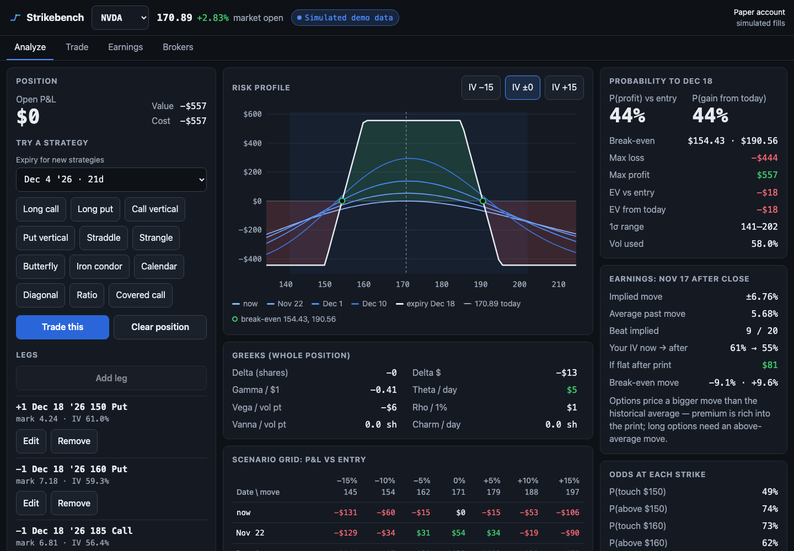
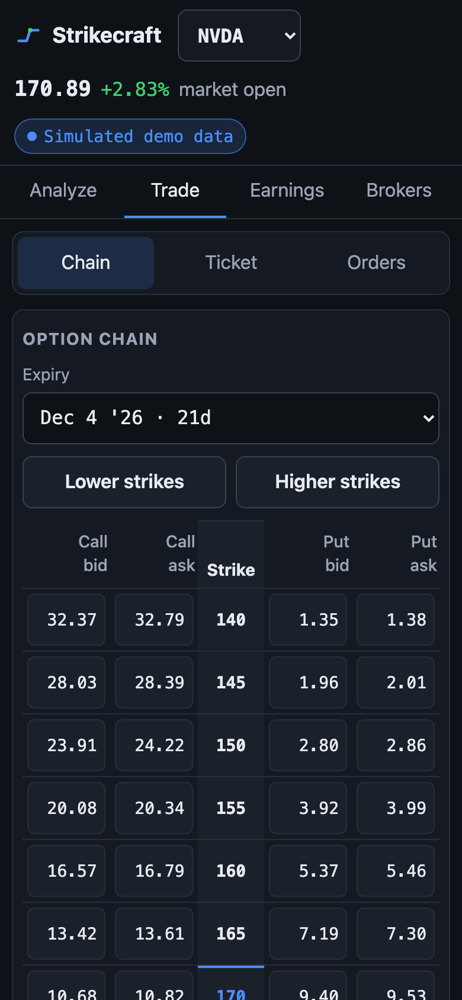
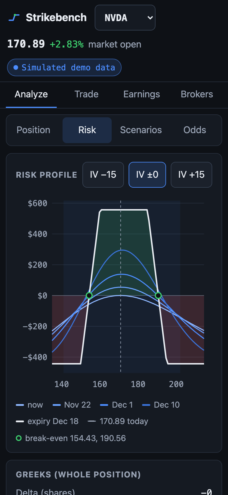
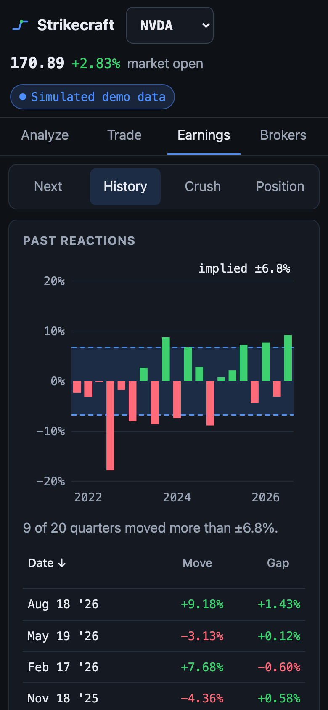
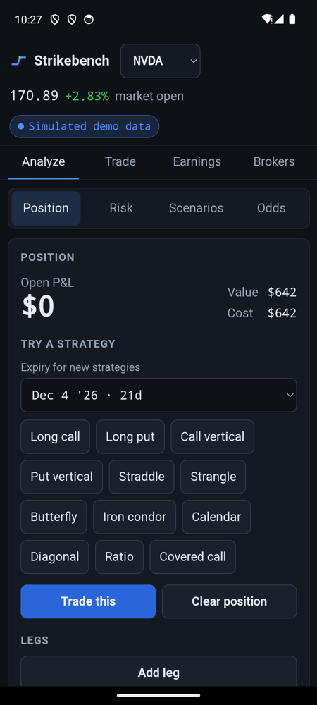

# Strikecraft

A free, open-source options workstation. It analyzes and trades through **your own broker API key**, runs on **your own machine**, and works on a phone.

```bash
npx strikecraft          # opens http://localhost:4173
npx strikecraft --demo   # try it on built-in simulated data: no account, no network
```

**[Try the demo in your browser](https://strikecraft.pages.dev)**: simulated data, nothing to install, and it installs to a phone's home screen.



## What it does

| Screen       | What you get                                                                                                                                                                                                                                                                                        |
| ------------ | --------------------------------------------------------------------------------------------------------------------------------------------------------------------------------------------------------------------------------------------------------------------------------------------------- |
| **Analyze**  | Build a position leg by leg or from a template (verticals, condors, calendars, …). Risk profile by date and by IV shift, a scenario grid, position greeks, probability of profit, break-evens, expected value, odds of touching each strike, and what the next earnings print does to the position. |
| **Trade**    | Option chain with one tap to buy an ask or sell a bid, a multi-leg ticket, a **broker preview before anything is sent**, and working / filled orders with cancel.                                                                                                                                   |
| **Earnings** | The move options are pricing against every past earnings reaction, the IV crush per expiry, and your position's P&L through the print.                                                                                                                                                              |
| **Brokers**  | Connect a broker with your own key, see which data source every price comes from, and the live-trading switch (off by default).                                                                                                                                                                     |

<p>



</p>

## How your data and keys are handled

- **Nothing goes through a server of ours.** There isn't one. `npx strikecraft` starts a small server on your machine; it talks to your broker and to public data sources directly.
- **Your key stays on your machine**, in `~/.strikecraft/config.json`, readable only by you (mode 0600). It is sent to exactly one place: the broker it belongs to. A test asserts this on every route ([`apps/server/test/server.test.ts`](apps/server/test/server.test.ts)).
- **Live orders are off by default.** Until you switch on "Allow live orders", no order can reach a live account: the adapter refuses before any request is made. Sandbox and paper orders always work. Every order is previewed with the broker first, and what is sent is exactly what was previewed.
- **Every price names its source.** The top bar says whether a quote is real-time from your broker or delayed from a public feed. A delayed number never passes for a live one.

## Market data

Sources are stacked; the first that answers wins.

1. Your connected broker (real-time with most funded accounts)
2. Any other connected broker
3. Yahoo Finance (public, about 15 minutes delayed, personal use)
4. Cboe delayed quotes (public, 15 minutes, reference)

Earnings dates come from SEC EDGAR filings.

## Brokers

| Broker                                                              | Status                                                                                                                                          |
| ------------------------------------------------------------------- | ----------------------------------------------------------------------------------------------------------------------------------------------- |
| Tradier                                                             | Available: sandbox (paper) and live. Checked end to end against the real sandbox.                                                               |
| tastytrade                                                          | Available: certification sandbox (paper) and live, OAuth. Checked end to end against the real sandbox, including streaming quotes.              |
| Charles Schwab, Interactive Brokers, Alpaca, TradeStation, E\*TRADE | Planned, behind the same [`Broker` interface](packages/data/src/broker/types.ts). Adapters are welcome: see [CONTRIBUTING.md](CONTRIBUTING.md). |
| Paper account                                                       | Built in. Simulated fills, no account needed.                                                                                                   |

## On your phone

The UI is a phone layout in its own right (tabs for chain, ticket and orders; the scenario grid turns on its side). To use the copy running on your computer from your phone:

```bash
npx strikecraft --host 0.0.0.0
```

Open the printed address on the phone. Anyone who can reach that address can use your connected broker, so only do this on a network you trust.

**Installing it as an app** ("Install app" in Chrome, "Add to Home Screen" in Safari) needs HTTPS or `localhost`, because browsers only run a service worker on a secure origin. Two ways to get that without exposing anything to the internet:

- [Tailscale](https://tailscale.com): `tailscale serve 4173` gives the server an HTTPS address reachable only from your own devices. Start Strikecraft with `--allow-host <your-machine>.<tailnet>.ts.net`.
- Android over USB: `adb reverse tcp:4173 tcp:4173`, then open `http://localhost:4173` on the phone.



## The math, and why you can check it

The pricing core ([`packages/core`](packages/core)) has zero dependencies and is tested against published textbook values: Black-Scholes-Merton and the greeks against Hull and Haug, the American binomial against Cox-Ross-Rubinstein, the normal CDF against West (2005). The vectors are in [`docs/test-vectors.md`](docs/test-vectors.md) and run on every commit:

```bash
npm test
```

The UI is tested against the same core: an end-to-end test loads a position and asserts that the numbers on screen equal what the core computes for the same inputs ([`e2e/analyze.spec.ts`](e2e/analyze.spec.ts)).

Models and their limits are stated, not hidden: probabilities assume a lognormal distribution at the position's implied volatility; American options use a 400-step binomial; implied volatility is solved from the mid, or from the last trade (flagged) when there is no usable quote.

## Options

```
strikecraft [options]
  --port <n>         Port to listen on (default 4173; 0 picks a free one)
  --host <addr>      Address to bind (default 127.0.0.1)
  --allow-host <h>   Extra host name to accept (a tailnet or LAN name). Repeatable.
  --demo             Built-in simulated data: no network, no broker
  --data-dir <dir>   Where keys and settings are kept (default ~/.strikecraft)
  --no-open          Do not open the browser
```

## Develop

```bash
git clone https://github.com/studio-corsair/strikecraft && cd strikecraft
npm install
npm run dev            # API server on :4173 (add -- --demo for simulated data)
npm run dev -w @strikecraft/web   # UI with hot reload on :5173
npm test               # unit and contract tests
npx playwright test    # end-to-end tests on the demo
```

| Package                          | What it is                                                                                |
| -------------------------------- | ----------------------------------------------------------------------------------------- |
| [`packages/core`](packages/core) | Options math. Zero dependencies, runs anywhere.                                           |
| [`packages/data`](packages/data) | Market-data sources, the source ladder, broker adapters, and the service the UI talks to. |
| [`apps/server`](apps/server)     | The local server: serves the UI, keeps keys, proxies broker calls.                        |
| [`apps/web`](apps/web)           | The UI (React). Also builds as a static, server-less demo.                                |

## Not investment advice

Strikecraft is software, not a broker or an adviser. Options can lose more than you put in. Check every order before you send it.

## License

[Apache-2.0](LICENSE). Strikecraft is an independent project and is not affiliated with any broker or trading platform.
